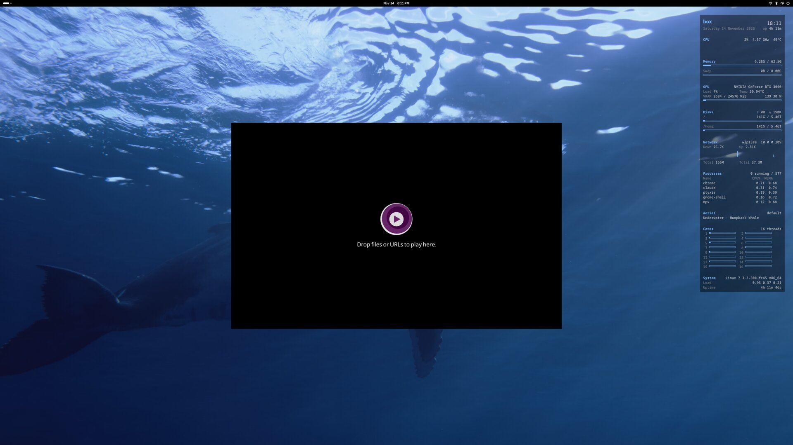
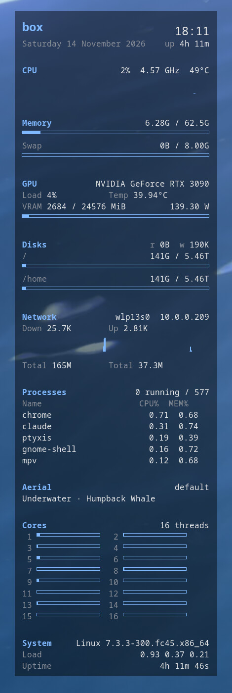
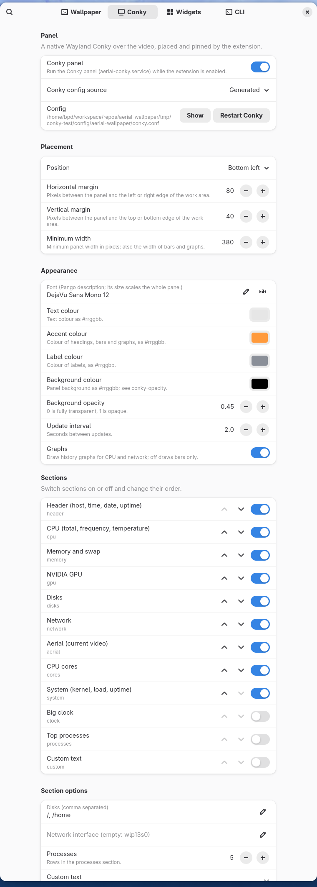
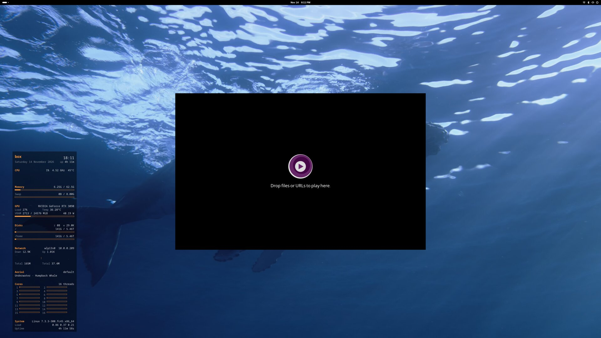
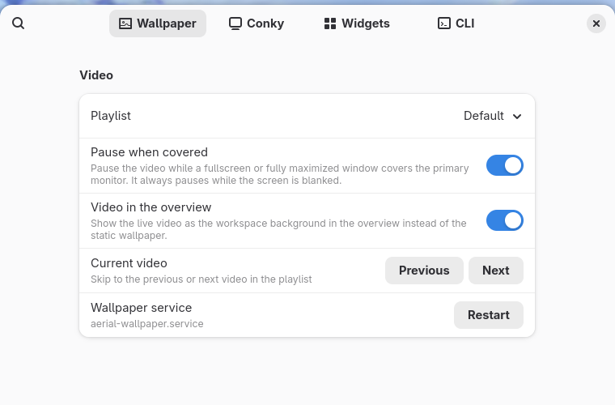
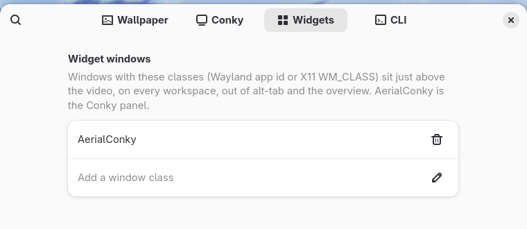
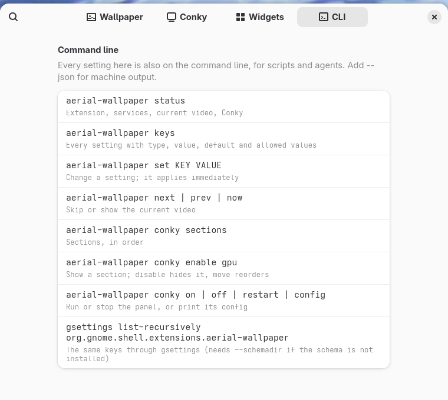

# aerial-wallpaper

Plays the Aerial videos (`wall-aerial`, mpv) as the GNOME desktop background on GNOME Shell 51 (Wayland).

The same panel restyled and moved from the CLI (`aerial-wallpaper set conky-position bottom-left`,
`set conky-accent-color "#ff9a3c"`, `conky disable processes`):

| Wallpaper | Widgets | CLI |
|---|---|---|
|  |  |  |

Screenshots come from `tests/conky-test.sh` (headless shell, 3840x2160 virtual monitor; the black window is a
plain mpv window used to check stacking).

- `extension/` — GNOME Shell extension `aerial-wallpaper@viablesys`. It runs one mpv per monitor that plays
  (`aerial-wallpaper@MONITOR.service`, MONITOR = the connector, e.g. `DP-1`), finds each mpv window (Wayland app
  id `aerial-wallpaper-MONITOR`), retypes it as a DESKTOP window (`Meta.Window.set_type`), hides it from window
  lists, sticks it to all workspaces and sizes it to its monitor. It pauses each mpv over its IPC socket
  (`$XDG_RUNTIME_DIR/aerial-mpv-MONITOR.sock`) while the screen shield is up, or a fullscreen or fully maximized
  window covers that monitor. It starts the units on enable and stops them on disable; the shell disables user
  extensions on lock, so mpv stops while locked. The current layout goes to
  `$XDG_RUNTIME_DIR/aerial-wallpaper/state.json` for the CLI and the preferences window.
- **Monitors** (`extension/monitors.js`, setting `monitors`): a matrix of connector (or `primary`) → overrides.
  Per monitor: `aerial` (video on/off), `playlist` (a playlist or a category such as `Space`), `conky` (panel
  on/off), `pause-when-covered`, and any `conky-*` key (position, margins, sections, font, colours, ...). With no
  entries only the primary monitor plays, as on a single monitor. For example:

      aerial-wallpaper monitor primary set conky-position top-right
      aerial-wallpaper monitor HDMI-A-1 set playlist Space conky true conky-position bottom-left conky-sections clock,aerial
      aerial-wallpaper monitors          # what each connected monitor shows
      aerial-wallpaper next --monitor HDMI-A-1
- `bin/wall-aerial` — the mpv launcher (playlists from `~/Videos/aerial/.meta/playlists/`, default from `.meta/default`,
  skip list, IPC socket). `AERIAL_MODE=wallpaper` gives a borderless window with all mpv keyboard/mouse input off;
  `AERIAL_INSTANCE` names the monitor (app id, socket) and `AERIAL_PLAYLIST` its playlist, and `bin/aerial-now.lua`
  records that monitor's current video for its Conky panel. Otherwise fullscreen with mpv's bindings. Installed as a
  symlink in `~/.local/bin/`.
- `systemd/aerial-wallpaper@.service` — runs `wall-aerial` in wallpaper mode for one monitor (playlist from the
  `%t/aerial-wallpaper/MONITOR.env` file the extension writes). Conflicts with `aerial.service` (the fullscreen player).
- `tests/headless-test.sh` — runs a throwaway headless gnome-shell (own D-Bus, dconf, data and runtime dirs)
  with the extension, checks adoption, size, playback and pause/resume under a maximized window.
- `tests/multimon-test.sh` — the same with two virtual monitors (`Meta-0` 4K primary, `Meta-1` 1080p) and
  per-monitor settings: one mpv and one Conky each, placement, per-monitor pause, CLI changes applied live,
  stacking, and the Monitors preferences page (`tmp/multimon-test/run/*.png`).

- **Settings** (`extension/schemas/`): playlist, pause when covered, video in the overview, widget windows,
  per-monitor overrides, and the Conky panel (on/off, generated or custom config, position, margins, width, font, colours, opacity,
  interval, graphs, sections and their order, disks, interface, process rows, custom text). Three equal ways in:
  - the preferences window (`extension/prefs.js`; Extensions app, or `aerial-wallpaper prefs`);
  - `bin/aerial-wallpaper`, the CLI for scripts and agents: `status`, `keys`, `get`/`set`/`reset`, `playlists`,
    `monitors`, `monitor M show|set|unset|reset`, `next`/`prev`/`now`, `conky sections|enable|disable|move|on|off|restart|config`,
    `log`; `--json` on reads, `--monitor M` for `next`/`prev`/`now`/`conky config`;
  - `gsettings --schemadir extension/schemas ... org.gnome.shell.extensions.aerial-wallpaper`.
  The running extension applies every change immediately.
- **Conky panels**: `extension/conky.js` writes `~/.config/aerial-wallpaper/conky-MONITOR.conf` for each monitor
  that shows a panel (the global `conky-*` settings with that monitor's overrides) and
  `systemd/aerial-conky@.service` runs Conky on it as a native Wayland client (Conky reloads the file on change).
  GNOME has no layer-shell, so Conky can't place or stack itself; the extension adopts each window (class
  `AerialConky-MONITOR`) like the video: desktop layer just above the video, all workspaces, out of alt-tab, the
  overview and the dash, placed on its monitor's work area by `conky-position` and the margins. Other classes
  listed in `widget-classes` get the same treatment without placement.
- `tests/conky-test.sh` — headless shell with the video, Conky and a normal window: adoption, stacking, alt-tab
  and dash membership, placement and live reload driven through the CLI, and screenshots of the desktop and
  every preferences page (`tmp/conky-test/run/*.png`).

Install (needs a log out and back in on Wayland before the shell sees a new extension):

    glib-compile-schemas extension/schemas   # after every schema change
    ln -s "$PWD/extension" ~/.local/share/gnome-shell/extensions/aerial-wallpaper@viablesys
    ln -sfn "$PWD/bin/wall-aerial" ~/.local/bin/wall-aerial
    ln -sfn "$PWD/bin/aerial-wallpaper" ~/.local/bin/aerial-wallpaper
    cp systemd/aerial-wallpaper@.service systemd/aerial-conky@.service ~/.config/systemd/user/ && systemctl --user daemon-reload
    # log out and in, then:
    gnome-extensions enable aerial-wallpaper@viablesys

Upgrading from the single-monitor version (units `aerial-wallpaper.service`, `aerial-conky.service`): install the
template units as above and log out and in; then the old unit files and `~/.config/aerial-wallpaper/conky.conf`
are unused and can be deleted.

Test hooks: `AERIAL_WALLPAPER_NO_SYSTEMD=1` (run the players and panels as child processes of the shell instead of
systemd units), `AERIAL_WALLPAPER_DEBUG=1` (log starts, placement and pauses).
